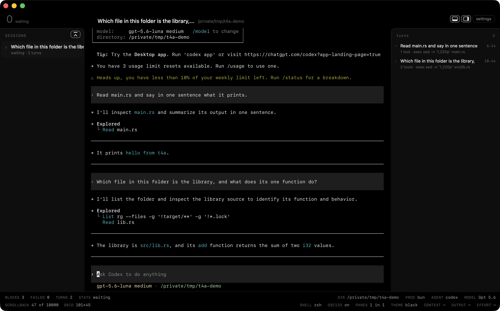
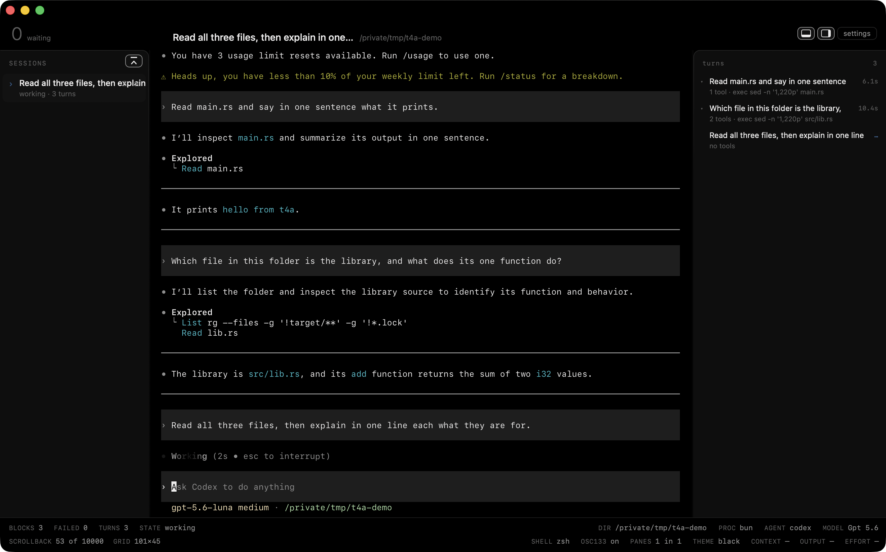
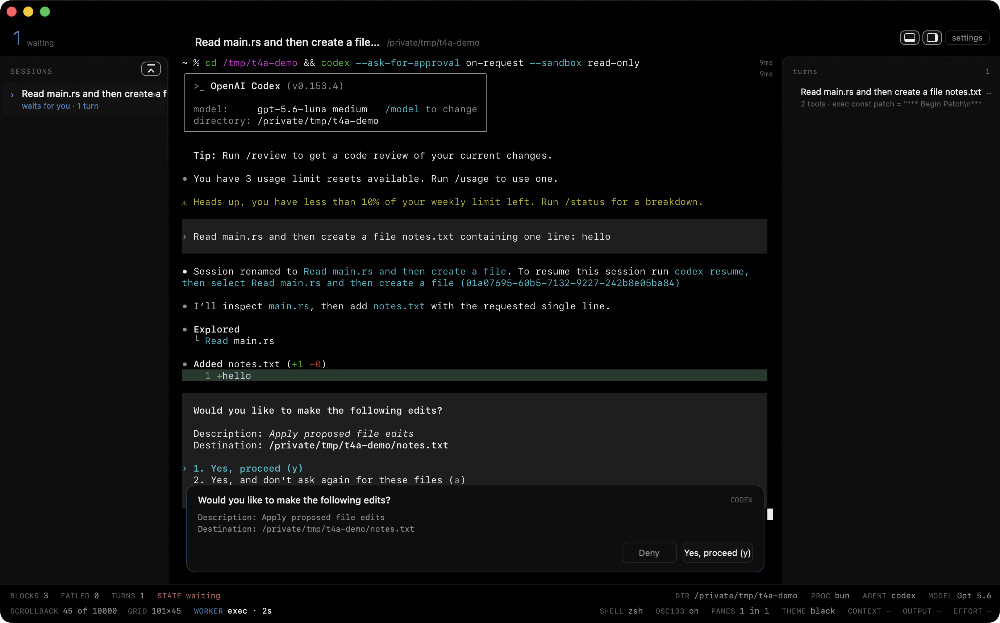
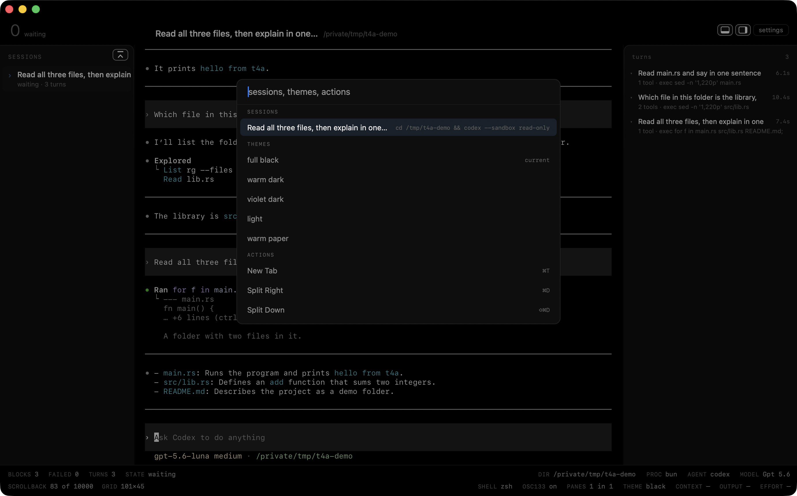
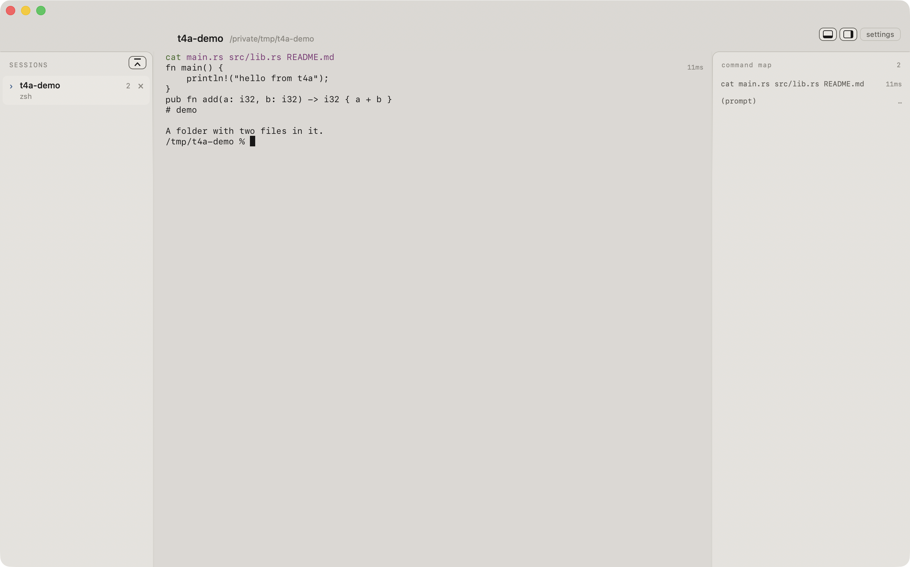
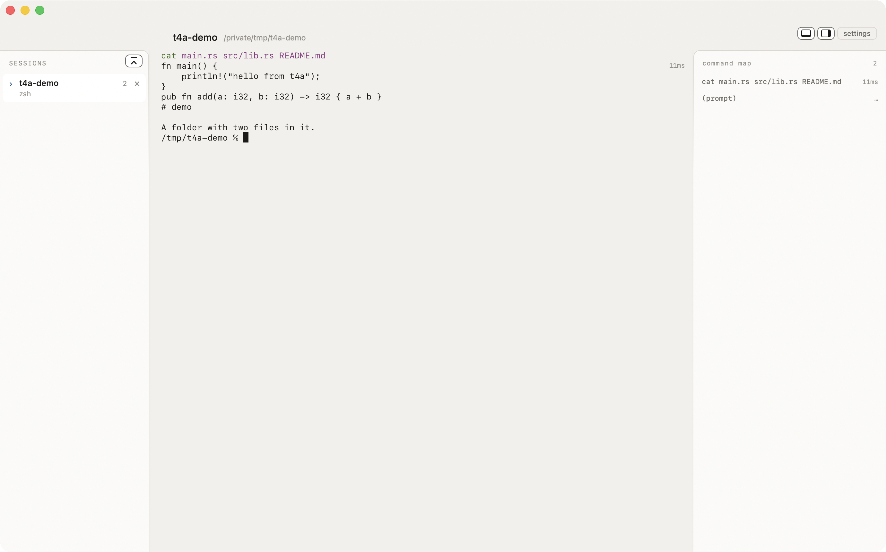
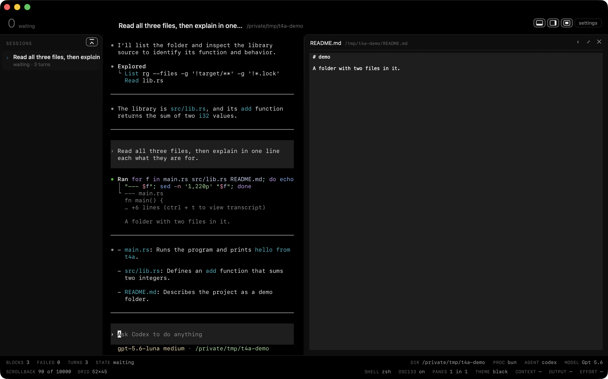

# T4A

**A GPU-drawn macOS terminal that treats agent sessions as objects.**

Your coding agents — Claude Code, Codex — are ordinary terminal processes. T4A runs them
exactly as your shell would, and the window *knows what it is looking at*: which session is
waiting for you, where one turn ended and the next began, and when a permission request is
sitting on screen waiting for a keystroke.



> ### 0.1.0 — the first public release
>
> T4A has been the author's daily terminal since 2026-08-19 and satisfies 238 of its own
> written, verifiable criteria. What each release changes is in [CHANGELOG.md](CHANGELOG.md). It has also only ever run on **one Mac, in front of two
> agents, in one person's habits**. That is not a track record, it is an anecdote.
> **Expect bugs.** The ones already known are named under [Known limits](#known-limits) rather
> than left for you to find; everything else is young code that has never met your setup.
> Issues and reproductions are welcome, and a report with a `Scripts/bench-*.sh` around it is
> worth ten without one.

## What it is good at

Five things, and together they are the reason to run this instead of a terminal you already
like.

**It tells you which session wants you, before you ask.** With four agents open, the question
you keep answering by hand — *who is blocked on me?* — is answered in the rail at a glance,
sorted so the ones waiting for you come first, with a mark on the tab that says whether a chat
has finished or has a decision queued. This is the whole point of the program; everything else
is in service of it.

**A dashboard instead of scattered noise.** Model, context, output and effort sit in a fixed
bar along the bottom of the window, read straight out of the session's own file — no
configuration, no provider to install, and never a number it invented. Those four facts already
exist in the agent's scrollback: strewn across a thousand lines, in four different shapes, gone
the moment you scroll. Here they are in one place, always the same place, clean and in the same
order every time — and in **tokens**, not in a percentage no terminal can compute honestly.
Anything else you want down there, a budget or a build or a queue, arrives from a program you
choose: see [Facts provider](#facts-provider).

**A permission is a card, not a wall of text.** With the chat page enabled, the request is
lifted out of the TUI with the diff or the command inside it, and Approve sends the real keystroke
into the real PTY — the agent never knows the difference. The card re-reads the screen before
it types, so something that merely *looks* like a permission cannot make it fire.

**It is fast, and the numbers are in the open.** 0.142 ms of GPU per frame scrolling a 229 MB
log at 120 Hz, zero frames dropped out of 3,625, and zero frames drawn while nothing changes.
Measured on the machine below, and reproducible with the benches in `Scripts/`.

**It is a terminal and it stays one.** No proxy, no protocol of ours, no bundled SDK, no API
key, no account, no telemetry, and no network traffic of its own. Your CLI binary, your
subscription. If T4A disappeared tomorrow your sessions would be normal terminal sessions.

## Install

```sh
brew install --cask xmasyx/tap/t4a
```

The cask is signed with the project's own certificate and **is not notarized**, so once, after
the first install:

```sh
xattr -dr com.apple.quarantine /Applications/T4A.app
```

You never have to do that again: later updates go through the button described under
[Updates](#updates), which clears the flag itself.

Or build it yourself — see [Build](#build). There is no other install path, and nothing is
downloaded behind your back.

## Why it exists

A terminal sees one long-running process printing text. An agent session has structure —
turns, tools, a state, a permission that is blocking — and none of it survives the trip
through a PTY, because an agent turn lives *inside* a single command that runs for hours.
Shell integration (OSC 133) cannot bend that far.

The GUIs that solve it abandon the terminal. T4A does the opposite: it stays a terminal and
reads the structure from data that already exists on your disk — the transcripts the agents
write anyway — plus the screen itself.

If T4A disappeared tomorrow, your sessions would be normal terminal sessions.

## What it does

**Turn blocks.** Each turn is a block in the scrollback, with its own duration in the gutter.
The block is the unit you navigate, not the line.

**A state you did not have to ask for.** The rail shows which sessions are working, which are
idle, and which are waiting for *you* — sorted so the ones that want you come first. The turn
map on the right lists every turn with its tools and its duration, and the open one while it
runs.



**You type where the agent reads.** By default T4A adds nothing between you and the agent's own
input line: no bubble, no second text field. The grid is the terminal, the agent's prompt is
the prompt. A composer under the window exists as an option (`composer-mode = agent` or
`always` in the configuration), off by default.

**Approval cards.** With the chat page enabled (`chat-page = true`; `⌥⌘1` shows it; off by
default), when an agent asks for permission the question is lifted out of the TUI into a card
with the diff or the command inside it, over whichever view you are looking at. Approving sends the
real keystroke into the real PTY — there is no side channel, and the agent never knows the
difference.



A card only appears on a *permission*: a list of options containing both halves of a decision,
a yes and a no. An ordinary menu — `/model`, a picker, a numbered list — is left alone. On the
raw grid, the agent's own prompt is left exactly as it is.

**A command palette.** ⌘K: sessions, themes, actions, in one list.



**Five built-in themes** — `black`, `warm`, `violet`, `light`, `paper` — switching live,
plus your own as `~/.config/t4a/themes/<name>.toml`.





**A Metal renderer** written against a cell grid, with the CPU renderer always alive behind a
flag. Measured on this machine, scrolling a 229 MB log at a measured 120 Hz for 30 s:

| | measured | budget |
|---|---|---|
| GPU time per frame (median) | 0.142 ms | 1.0 ms |
| CPU time per frame (median) | 0.079 ms | 0.5 ms |
| dropped frames over 3,625 frames | 0 | 0 |
| frames drawn while nothing changes | 0 in 11.0 s | 0 |

When nothing changes, the display link is stopped — not throttled.

**Pure chat (experimental, off).** With the chat page on, an optional mode covers the engine's
own prompt furniture while it is resting, so a session reads as a conversation. It uncovers
itself the moment anything needs your keyboard.

**File preview, inside the terminal.** When the agent writes a file, its name becomes a link on
the chat page; clicking it opens the file **in the window you are already in**, in the right
panel, with QuickLook. No editor, no second app, no separate page.



The chain is: a pane with `claude` or `codex` attached, the chat page (`⌥⌘1` moves between it
and the raw terminal), a step that wrote a file carrying its path, and a click on that path. The
panel widens for the preview, the button in the band collapses and reopens it (`⌥⌘P`), and
`⇧⌥⌘P` brings the same preview forward as a card over the window. On the raw grid, `⌘`-click on
a path opens the file in its own application, as iTerm does.

It is **read-only in the strict sense**: T4A hands QuickLook a path and never writes anything
back, and the file is read from the disk at the instant you click — never rebuilt from the
transcript, so what you see is what is actually there now. A file that has been deleted since
says so instead of showing you a ghost.

## The door

The door lets an ordinary local program open a tab in a directory, run one command there,
and close that pane later if doing so would interrupt nothing. It is a per-user directory of
small JSON request and reply files: `~/.cache/t4a/door` by default, or the non-empty value of
`T4A_DOOR`. A directory is deliberate. A `t4a://` URL could be opened by any web page; a file
under `~/.cache/t4a/door` can only be placed by a process running as you.

Each request has a name made only from `A-Z`, `a-z`, `0-9`, `.`, `_` and `-`; the name cannot
be empty, `.` or `..`. T4A consumes a request before opening or closing anything, then writes
one reply with the same name.

To open a tab, write `<name>.open.json`:

```json
{"cwd":"/tmp","command":"printf 'door opened\\n'","label":"Door example"}
```

`cwd` must be an existing absolute directory. `command` is trimmed, must be non-empty and one
line, and may be at most 4096 UTF-8 bytes. `label` is optional, trimmed, and may be at most 80
characters. Success creates `<name>.opened.json`, for example
`{"session":"7D44C8DD-66A7-4B95-9E39-9B0D70D0818F"}`. A bad request opens nothing and creates
`<name>.rejected.json`, for example `{"reason":"command has more than one line"}`.

To close the pane later, write `<name>.close.json` with the returned session:

```json
{"session":"7D44C8DD-66A7-4B95-9E39-9B0D70D0818F"}
```

The reply is `<name>.closed.json`. Its four outcomes are:

| outcome | reply | meaning |
|---|---|---|
| `true` | `{"closed":true}` | the pane was idle and closed |
| `working` | `{"closed":false,"reason":"working"}` | closing would interrupt it |
| `unknown` | `{"closed":false,"reason":"unknown"}` | that session does not exist |
| `last` | `{"closed":false,"reason":"last"}` | it is T4A's final pane |

Publish a request with `mv`, so T4A never sees half-written JSON, then wait for either reply:

```sh
door=${T4A_DOOR:-"$HOME/.cache/t4a/door"}
name="door-$(date +%s)-$$"
mkdir -p "$door"
tmp=$(mktemp "$door/.open.XXXXXX")
printf '%s\n' '{"cwd":"/tmp","command":"printf door-opened","label":"Door example"}' >"$tmp"
mv "$tmp" "$door/$name.open.json"
while [ ! -f "$door/$name.opened.json" ] && [ ! -f "$door/$name.rejected.json" ]; do sleep 0.05; done
reply="$door/$name.opened.json"; [ -f "$reply" ] || reply="$door/$name.rejected.json"
cat "$reply"
```

## Privacy, stated as something you can check

- **T4A makes no network requests you did not ask for.** Not at launch, not on a timer, not
  while you work. There is no account and no telemetry. `lsof -nP -i -a -p <T4A pid>` is empty
  and `nettop` reports zero bytes for as long as you leave it alone — the single exception is
  the **Check for updates** button under [Updates](#updates), which asks GitHub for the latest
  release tag when, and only when, you press it. The agents running *inside* T4A talk to their
  vendors, because that is their job — that traffic belongs to their processes, not to T4A.
- **T4A never writes into your agents' directories.** `~/.claude` and `~/.codex` are opened
  read-only, and the file descriptors are `O_RDONLY`.
- **Your own subscription, no API key.** The engine is *your* CLI binary running in the PTY,
  billed to whatever plan you already have. T4A bundles no SDK, stores no key, and never
  reimplements the chat.
- **One configuration file**, `~/.config/t4a/config.toml`, plain text, and everything the UI
  changes is written back into it.

## Security, stated the same way

A terminal is a place where any program you run can print escape sequences at the emulator.
What T4A does with the ones that matter:

- **The bench's remote-control channel is not in the binary you download.** `TestChannel` — the
  fifo that types into panes, presses the approval card and dumps the app's state — is compiled
  only into a debug build or one asked for it with `-DT4A_TESTABLE`. `Scripts/build-app.sh
  release` builds without it and then refuses to finish if the symbols are still there.
- **`OSC 52` clipboard reads are refused.** The query form — a program prints `ESC ] 52 ; c ; ? ST`
  and a terminal replies with your clipboard *as keyboard input* — returns nothing here, and the
  refusals are counted so the behaviour can be measured rather than assumed.
- **`OSC 52` clipboard writes are honoured**, which is the reason the sequence exists: a remote
  editor yanking into your local clipboard. A program in a pane can therefore set your clipboard.
- **`OSC 0` / `OSC 2` set the tab title**, as in every terminal. A program can choose what its tab
  is called.
- **`OSC 9` and `OSC 777` raise real macOS notifications.** A program in a pane can put a banner
  on your screen.
- **The approval card re-reads the screen before it types.** When you click Approve, T4A scans the
  pane again and sends the keystroke only if the same question is still there; otherwise the card
  withdraws and says so. A card is a picture taken when the scan ran, and anything that prints can
  draw something shaped like a permission — so the click checks, and the recogniser also requires
  the terminal's cursor to be inside the box, which output cannot fake.
- **Automatic replies** are SwiftTerm's, and this is what they say. Read off the dependency at
  the version this repo pins (SwiftTerm 1.20.0, `5d14406`), because "not ours" is not an answer
  to "what does my terminal tell a program that asks":

  | A program prints | T4A replies |
  |---|---|
  | `ESC [ c` (Primary DA) | `CSI ?65;4;1;2;6;21;22;17;28c` — a VT525 with sixel, 132 columns, printer, DECSERA, horizontal scrolling, ANSI colour, terminal state interrogation and rectangular editing |
  | `ESC [ > c` (Secondary DA) | `CSI >65;20;1c` — VT525, firmware 20, PC keyboard |
  | `ESC [ 5 n` (DSR) | `CSI 0n` — "no malfunction" |
  | `ESC [ 6 n` (CPR) | `CSI <row>;<col>R` — **where your cursor is** |
  | `ESC [ ? 6 n` (DECXCPR) | `CSI ?<row>;<col>;1R` |
  | `ESC [ > 0 q` (XTVERSION) | `DCS >\|SwiftTerm 1.20.0+v1.20.0: ST` — the emulator's version |
  | `OSC 4 ; n ; ?`, `OSC 10/11/12 ; ?` | the colour in question, so a program can read your theme |
  | `OSC 21` | nothing; there is no handler for it |

  None of these carries anything about you except the cursor position and the colours of your
  theme, and both are what every xterm-compatible terminal answers. Nothing here is a T4A
  decision — change the emulator and this table changes with it, which is why it names a version.
- **`SGR 5` (blink) is parsed and not drawn.** The engine records the attribute, the GPU renderer
  ignores it, and text asking to blink is drawn steady rather than lost. Said out loud because a
  terminal that silently swallows an attribute is one you cannot reason about; measured in
  `Scripts/bench-atlas.sh`, where a whole screen of it renders without a dropped rectangle.

## Language

The interface speaks **English or Italian**, and follows the Mac by default:

```toml
language = "system"    # "system" (default), "en", "it"
```

Settings has the same three choices, and switching applies to the window you are looking at,
without a restart.

## Updates

**T4A never checks for updates on its own.** There is no timer, no launch check, and no
network traffic at all until you ask for one — the promise under
[Privacy](#privacy-stated-as-something-you-can-check) is meant literally.

When you do ask, Settings has a **Check for updates** button. If T4A came from the cask it runs
`brew upgrade --cask xmasyx/tap/t4a`, clears the quarantine flag on its own bundle and relaunches;
if you installed it by hand it opens the release page and leaves the rest to you.

## Requirements

- macOS 14 or later, Apple Silicon
- Swift 6 toolchain (Xcode 16 or the standalone toolchain)

## Build

```sh
swift build -c release
swift test
```

To assemble and install the app bundle:

```sh
./Scripts/build-app.sh release      # produces dist/T4A.app
open dist/T4A.app
```

`build-app.sh` parses every shipped shell script, builds in release, copies the shell
integration into the bundle read-only, writes `Info.plist` and ad-hoc signs the result —
local notifications need a signed bundle with a stable identifier.

`./Scripts/build-app.sh install` builds in release and installs straight into
`/Applications/T4A.app`. Building from source is a first-class path, not a fallback: the cask
under [Install](#install) ships exactly this bundle.

## First run

There is no configuration step. Open it and you get a login shell. Run `claude` or `codex` in
it the way you always would, and type where you always did: T4A attaches to the session on its
own and adds the rail, the turn map and the bar around it, nothing in front of it.

## The bar

The bar along the bottom says what a terminal knows, and it says it **only while a pane has
something attached**. With a bare shell in front of you it draws nothing at all and costs no
height — not a row of dashes, not a warning, not even the working directory. A bar full of
facts with no session behind them is not information, it is furniture.

The moment `claude` or `codex` is running in the pane it comes back whole, and four of its
rows are read out of the session's own file, with no configuration and no provider:

| Row | What it says |
|---|---|
| `MODEL` | the model the session is running on |
| `CONTEXT` | how big the context is right now, in tokens — `88.7k`, `305k` |
| `OUTPUT` | everything the agent has written this session, in tokens |
| `EFFORT` | how hard it was told to think, when its file says so |

**In tokens, never as a percentage.** A percentage needs the size of the window, and no
vendor writes that into its transcript: working it out from the model's name would be a
guess, and it would be wrong by a factor of five for a session running with a larger window
than its family's usual one. A row with no reading draws `—`, and never a number it made up.

Nothing is written anywhere for this. T4A opens the transcript the agent is already keeping,
read-only, and reads it.

## Facts provider

Everything else you might want down there — a budget, a build, a queue, the temperature of a
machine — lives in programs T4A has never heard of, so the bar takes a **path** and reads
lines.

```toml
facts-provider = "/path/to/facts-provider.sh"   # empty by default: nothing runs
facts-interval = 2                              # seconds
```

The contract, whole:

- T4A runs the program every `facts-interval` seconds with `--session <the agent's own session
  id, or empty> --cwd <the pane's directory> --agent <claude-code|codex|>`, off the drawing
  thread, and **kills it at one second**.
- It reads standard output: one reading per line, `key<TAB>text[<TAB>tone]`.
- `tone` is one of `ok warn critical live used dim accent muted`. It names a *meaning*; the
  theme decides the colour, and `warn` and `critical` are the two reds the rest of the bar
  already uses.
- **Repeat a key** to add another word to the same row, each word with its own tone — that is
  how a ladder or a scale comes out coloured word by word.
- `#name<TAB>key<TAB>Label` names the row **in the settings**. It is never printed on the
  bar: your readings already carry their own caption, and printing the name in front of them
  would say it twice and spend the width on it.
- Every key becomes a row like any other: switchable in **Settings → Dashboard rows**,
  draggable into any of the nine lines, remembered in `dash-slots` under `fact-<key>`.
- **The bar has three whole lines** under the six half ones, and that is where your rows
  arrive: four to a line, in the order you print them, and anything past the eighth lands on
  the third line switched off. A whole line spans the window, so a sentence stays a sentence —
  on a half line the same reading came out as `MEMORY OK · RE…`. They are lines like the
  others: drag a reading of yours onto a half line, or a row of T4A's onto a whole one.
- A whole line never shortens a cell while it still has room. When it runs out, the cutting
  starts at the **last** cell and works back, no cell going under twelve characters; only when
  they are all at that floor do cells drop off the end, with a `+N` saying how many. A row
  carrying a `warn` or a `critical` is never one of them.
- A key may contain letters, digits, `-` and `_`, up to 32 characters. Anything else is
  refused — the key is written into the configuration file, where `:` `,` and `|` mean
  something.
- **Words, not pictures.** The bar is a statusline: labels are words (`MEMORY`, `EFFORT`,
  `CONTEXT`) and readings are text. No emoji, no pictograms. T4A does not filter what you
  send — it draws it — so this one is on the provider.
- **Your program is run with your login shell's `PATH`**, not with the app's. An app opened from
  the Finder inherits launchd's environment, whose `PATH` is `/usr/bin:/bin:/usr/sbin:/sbin` — no
  Homebrew, no `~/.bun/bin`, no `~/.local/bin`. A `#!/usr/bin/env something` first line would
  never resolve there, and your provider would die at 127 without printing a byte. T4A asks your
  login shell once per launch and hands the answer to your program.
- Exit non-zero, or run past the second, and the previous values stay. Three of those in a row
  and the row is drawn dim: what you are reading is no longer being refreshed.
- **A warning cannot be switched off.** A reading whose tone is `warn` or `critical` appears at
  the end of the bar's second left line even when you have switched that row off, or left it on
  no line at all — one place to look, rather than wherever the row happens to sit — and it goes
  away by itself when the reading is calm again. A row that is on and placed draws where you put
  it and nowhere else: never twice. On a line too narrow, the calm readings give up their letters
  and the warning keeps all of its.
- **A provider that will not run says so.** The exit status and the first line it printed to
  stderr are kept, and a `FACTS` cell appears at the end of the bar's second left line naming the
  failure — `EXIT 127 · NOT ON PATH` — until the next answer arrives. Your stderr never becomes a
  reading; it only ever explains a failure. Without this, a provider dying every two seconds and
  a provider with nothing to say are the same empty bar.
- No provider, no process. The bar is exactly what it is without this feature.

`Scripts/facts-provider.example.sh` is a working one — clock, machine load, battery.

## Known limits

- **macOS and Apple Silicon only.** Linux and Windows are not planned for this version.
- **Two adapters:** Claude Code and Codex. Adding a vendor is a file in `Sources/AgentAdapters`
  plus a line in the registry — Gemini CLI is not done.
- **The chat page, the composer and pure chat are off by default**; the raw grid with the agent's own input is what a new install shows.
- **Not notarized.** It is signed with the project's own certificate, not with an Apple
  Developer ID, so macOS asks you to clear the quarantine flag once (see
  [Install](#install)). Nothing about that is unusual for a small open-source Mac app,
  and it is stated here rather than discovered by you at first launch.
- **Not an editor.** The centre of the window is a terminal and stays one.
- **A facts provider is a program you choose**, and T4A neither ships one nor knows what
  yours does. A cell that does not fit is truncated with an ellipsis rather than pushing its
  neighbours off the bar, and past that it is dropped behind a `+N`.
- **No reset windows, and there will not be any without a decision you make.** How much of
  your five-hour and weekly allowance is gone is the one number the bar cannot show. It is
  not in the transcript — searched for on 2026-08-25 across the whole of `~/.claude`, and it
  is not on disk at all. Claude Code hands it to whatever program is configured as its
  *statusline*, on standard input, and T4A could be that program only by writing itself into
  your `settings.json`. That file is yours, so the answer is no, and the row does not exist:
  a row that can never have a reading does not deserve to be on a bar. For the same reason
  `CONTEXT` is in tokens and not in per cent — the size of the window comes down the same
  pipe, and nothing else knows it.

## The demo

`demo/` holds the browser prototype the layout was decided in, before a line of Swift existed.
Open `demo/index.html` — no server, no build. Its data comes from a real recorded session,
anonymised; none of the turns are invented.

## License

MIT — see [LICENSE](LICENSE).

Terminal emulation is [SwiftTerm](https://github.com/migueldeicaza/SwiftTerm) by Miguel de
Icaza, also MIT. The GPU renderer, the agent adapters and the chrome are this project's.
